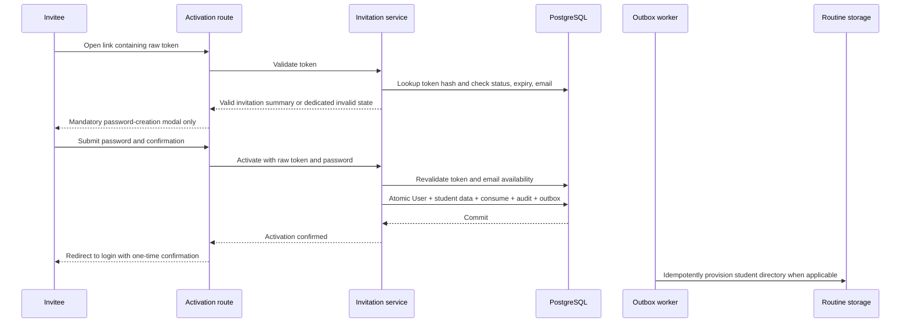

# Secure User Administration Through Invitations and Reversible Lifecycle Controls

**Status:** Approved design  
**Date:** 2026-09-13  
**Scope:** `agustinturriedf/web` user administration, invitations, activation, lifecycle, audit, and credential recovery

## Decision and outcome

Replace the current general-purpose users screen with three explicit views: **Students**, **Team**, and **Invitations**. All accounts are created through single-use invitations, roles become immutable at activation, account removal becomes reversible archival, and every sensitive change is authorized in the service layer and recorded in an append-only audit history.

The design uses one canonical account lifecycle on `User` for students and team members. Student-only operational data remains on `StudentProfile`. This removes the current split in which only students have a status and gives authentication, authorization, archival, and recovery one consistent source of truth.

Delivery is incremental. Each vertical slice includes its backend behavior, applicable UI, migration, tests, observability, and recovery procedure. This is not a rewrite and must not be implemented as a UI-only patch.

## Current-state risks

| Area | Current implementation | Risk |
| --- | --- | --- |
| Listing | `GET /api/users` calls `UserService.listUsers`, which returns an unfiltered Prisma list to both `ADMIN` and `TRAINER`. | Trainers can see and target team accounts they must never manage. The endpoint is also unbounded. |
| Creation | `POST /api/users` creates an account with a shared bootstrap password. | Shared credentials and direct creation bypass ownership proof, secure password choice, and a coherent activation audit trail. |
| Invitations | The invitation backend supports create, list, resend, and revoke, but is student-specific and the panel does not expose the queue. | Operators cannot reliably inspect or recover invitation delivery and lifecycle failures. |
| Activation | Activation always creates a `STUDENT`, `StudentProfile`, payment, and routine metadata. | Team activation cannot reuse the secure flow without generalization. |
| Editing | `PATCH /api/users/:userId` exists, while the panel edit action is a stub and the UI/service contracts disagree. The repository can update role and password hash. | A completed UI could accidentally expose privileged or immutable fields. |
| Removal | `DELETE /api/users/:userId` hard-deletes records, allows unscoped trainer use, and removes the physical routine directory after the database delete. | Unauthorized team deletion, irreversible loss, and database/filesystem divergence are possible. |
| Password recovery | Reset tokens are hashed and single-use, but delivery logs the reset URL rather than sending email. | Secrets enter logs and users do not receive the recovery message. |
| Session enforcement | JWT session data currently carries student status. | Lifecycle changes can remain stale in an existing session unless the server invalidates or revalidates it. |

## Goals

- Give `ADMIN` complete student and team administration while preserving explicit safety guards.
- Let `TRAINER` list and manage every `STUDENT`, regardless of trainer assignment, while preventing any team-account management.
- Make `ACTIVE`, `INACTIVE`, `BLOCKED`, and `ARCHIVED` distinct, enforced states.
- Make every account begin as an invitation and become active only after the invitee creates a compliant password.
- Make roles immutable after activation.
- Support assignment of any student to any active trainer by either an admin or trainer, with audit history.
- Expose safe, complete account history without credentials, raw tokens, or token hashes.
- Make email delivery and physical routine-directory provisioning idempotent, retryable, and observable.
- Give clients explicit, stable DTO and error contracts with optimistic concurrency.

## Non-goals

- Multi-tenant organizations or organization-scoped permissions.
- Role changes after activation.
- Physical user deletion from the panel.
- Operator-created, operator-visible, temporary, or shared passwords.
- Replacing the authentication framework.
- Unrelated refactoring of payments, routines, navigation, or profile management.

## Design principles

1. **The service layer is the authorization boundary.** UI visibility improves usability but never grants authority.
2. **Commands express intent.** Profile edits, lifecycle transitions, password recovery, and invitation actions have separate contracts.
3. **One canonical lifecycle avoids contradictory state.** `User.accountStatus` governs access for every role.
4. **Sensitive state changes are atomic with their audit event.** A successful mutation without its audit record is invalid.
5. **External side effects are durable work, not transaction participants.** Email and filesystem work use an outbox and idempotent workers.
6. **Responses expose application DTOs only.** Prisma records, `passwordHash`, `tokenHash`, and internal storage paths never cross the API boundary.

## Architecture

### Domain ownership

| Component | Responsibility | Must not own |
| --- | --- | --- |
| `User` | Identity, authentication material, immutable role, canonical account lifecycle, archival metadata, concurrency and session versions. | Student payment, trainer assignment, or routine fields. |
| `StudentProfile` | Student-only profile data, trainer assignment, payment and routine relationships. | A duplicate account status or archival source of truth. |
| `Invitation` | Pre-account identity data, immutable target role for that issuance, hashed token, lifecycle, expiration, and delivery state. | A `User` row before activation or any password value. |
| User application service | Permission matrix, state machine, immutable-field filtering, last-admin/self-archive guards, transactions, and DTO mapping. | Direct email or filesystem side effects. |
| Invitation application service | Conditional role validation, token issuance/rotation, activation transaction, and invitation DTOs. | Plaintext token persistence outside the encrypted delivery payload, or direct account creation outside activation. |
| `UserAuditEvent` | Append-only, safe history for invitation and account actions. | Passwords, hashes, raw tokens, reset links, or free-form secret-bearing payloads. |
| Outbox workers | Retriable email delivery and physical routine-directory provisioning. | Authorization or domain-state decisions. |

### Lifecycle placement decision

Add `accountStatus` and archival metadata to `User`, and migrate the current `StudentProfile.status` into it. Keeping archival only on `StudentProfile` would not support `ADMIN` and `TRAINER` accounts. Keeping statuses on both records would create two authorities and ambiguous authentication behavior. A single `User` lifecycle is therefore the coherent model for students and team members.

`StudentProfile` remains the owner of student operations such as trainer assignment, initial payment, routine metadata, and body/profile fields. Existing consumers of `studentProfile.status` must migrate to `user.accountStatus` in the same slice; the old column is removed only after all reads have moved.

### Request path

1. A route authenticates the actor and validates route, query, and body DTOs.
2. The application service authorizes the actor against the target role and requested action.
3. The service validates immutable fields, state transitions, invariants, and `expectedVersion`.
4. A repository transaction mutates domain records, increments the version, appends audit events, and enqueues side effects.
5. The route maps the result to an explicit DTO and never serializes a Prisma record directly.
6. The UI reconciles from the returned DTO or refetches the affected list/detail resource.

## Permission matrix

`Team` means users whose role is `ADMIN` or `TRAINER`. Conditions in the table are mandatory service checks.

| Action | `ADMIN` | `TRAINER` | Conditions |
| --- | --- | --- | --- |
| List/search students | Allow | Allow | Includes all students, not only assigned students. |
| View student detail and audit | Allow | Allow | Safe DTO and safe audit metadata only. |
| Edit student profile | Allow | Allow | Role, password, and lifecycle fields are rejected. |
| Assign/reassign a student | Allow | Allow | Destination must be an active `TRAINER`; every change is audited. |
| Pause/reactivate/block/unblock/archive/restore a student | Allow | Allow | Valid transition, reason, and expected version are required. |
| Invite a student | Allow | Allow | May assign the invitation to any active trainer. |
| List/resend/revoke student invitations | Allow | Allow | Scope includes all student invitations. |
| List/search team | Allow | Deny | Team view is admin-only. |
| View team detail and audit | Allow | Deny | Trainer requests are rejected by the service. |
| Edit team profile | Allow | Deny | Role and password remain immutable. |
| Transition a team account | Allow | Deny | Self-archive and last-active-admin guards apply. |
| Invite an admin or trainer | Allow | Deny | Student-only fields are rejected. |
| Resend/revoke team invitations | Allow | Deny | Target role is checked on every command. |
| Request panel password recovery | Allow | Students only | A trainer may trigger recovery only for a student; an admin may trigger it for any account. No password is returned. |
| Change an activated role | Deny | Deny | Revoke and reissue only while the invitation is pending. |
| Physically delete an account | Deny | Deny | No panel or supported API path exists. |

The API returns `403 FORBIDDEN` for authenticated actors outside their allowed role/target scope. It must not trust a target role supplied by the client; it loads the target before authorization.

## Account state machine

### State meanings

| State | Meaning | Authentication/access behavior |
| --- | --- | --- |
| `ACTIVE` | Normal account operation. | May authenticate and use authorized application features. |
| `INACTIVE` | Temporary operational pause. | Sign-in and protected access are denied until reactivated. |
| `BLOCKED` | Administrative or security restriction. | Sign-in and protected access are denied; UI distinguishes this from a pause. |
| `ARCHIVED` | Reversible removal from normal operation and default lists. | Sign-in and protected access are denied; account remains restorable and auditable. |

### Allowed transitions

| Command | From | To | Notes |
| --- | --- | --- | --- |
| `pause` | `ACTIVE` | `INACTIVE` | Temporary pause. |
| `reactivate` | `INACTIVE` | `ACTIVE` | Restores normal access. |
| `block` | `ACTIVE`, `INACTIVE` | `BLOCKED` | Administrative/security restriction. |
| `unblock` | `BLOCKED` | `ACTIVE` | Explicitly restores normal access. |
| `archive` | `ACTIVE`, `INACTIVE`, `BLOCKED` | `ARCHIVED` | Reversible removal; records archival metadata. |
| `restore` | `ARCHIVED` | `INACTIVE` | Conservative restore; clears current archival columns after the audit event captures them, and requires a separate `reactivate` command for access. |

Every transition requires a nonblank reason, records actor and server time, increments `version` and `authVersion`, and emits one audit event in the same transaction. Repeating a command whose target state is already current returns `409 INVALID_STATE_TRANSITION`; it is not treated as a silent success.

Additional invariants:

- An admin cannot archive their own account.
- A transition affecting an admin must leave at least one `ACTIVE` admin. This applies to pause, block, and archive, not only archive.
- The last-active-admin check and update execute in one PostgreSQL `SERIALIZABLE` transaction with bounded retry on serialization failure, preventing concurrent write skew.
- Archived email addresses remain reserved. Operators restore the account rather than invite a duplicate identity.
- A lifecycle change invalidates existing sessions through `authVersion`; protected requests must compare the session claim with the current user record or an equivalent server-side revocation check.
- Physical deletion remains an offline, separately governed data-retention operation outside this module.

## Invitation and activation

### Invitation rules

- Every account starts as an `Invitation`; invitation creation does not create `User`.
- Only an admin can invite an `ADMIN` or `TRAINER`.
- An admin or trainer can invite a `STUDENT`; the selected trainer must currently be an active `TRAINER`.
- Each issuance stores normalized email, first name, last name, immutable `targetRole`, a unique SHA-256 token hash, lifecycle and delivery statuses, creation/update times, and a 48-hour expiration.
- `trainerId` and student profile/payment fields are accepted only when `targetRole` is `STUDENT`; they are rejected for team invitations.
- An activated account's role cannot change. A wrong pending role is corrected by revoking the invitation and issuing a new one.
- Raw invitation tokens are never stored on `Invitation`, returned by list/detail APIs, logged, or included in audit metadata. To support asynchronous retry, the delivery outbox may hold the raw token only in an application-encrypted payload with restricted worker access; the worker deletes that payload after successful delivery or invitation expiry.
- Resend rotates the token, invalidates the previous token, resets expiration to 48 hours, and enqueues a new idempotent delivery. Consumed invitations cannot be resent or revoked. A revoked or expired invitation requires a replacement issuance.

### Status representation

Invitation lifecycle and delivery are separate dimensions:

- `status`: `PENDING`, `CONSUMED`, or `REVOKED`; API projection reports `EXPIRED` when an unconsumed, unrevoked invitation is past `expiresAt`.
- `deliveryStatus`: `PENDING`, `SENT`, or `FAILED`, with attempt count, last attempt time, sent time, and a safe error category.

Separating these values prevents an email transport failure from being confused with invitation invalidity. A create or resend response reports that the invitation exists and delivery is pending; it does not roll back the invitation because an email provider is unavailable.

### Activation sequence



The email link carries the token in the URL fragment (`/activation#token=...`) so browsers do not send it in HTTP requests or referrer headers. The activation client captures it in memory, immediately removes the fragment with `history.replaceState`, and submits it in request bodies only. The route renders no administrative shell or content behind the modal. Its first and only primary interaction is mandatory password creation. The modal contains password and confirmation fields, a visible policy, field and server errors, a loading state, initial focus, focus trapping, labelled controls, error announcements, and focus restoration where applicable. It cannot be dismissed, bypassed, or navigated into the private application.

On submit, the service hashes the supplied token, reloads the invitation, and rechecks token match, status, expiration, target-role rules, and email availability. In one database transaction it:

1. Creates the `User` with `ACTIVE` status, immutable role, and password hash.
2. For a student, creates `StudentProfile`, initial payment, and routine-folder metadata.
3. Marks the invitation consumed using a compare-and-set condition on invitation ID, token hash, and status.
4. Adds activation and related creation audit events.
5. Enqueues idempotent physical routine-directory provisioning for a student.

The recommended success behavior is redirecting to login with an opaque, one-time confirmation state rather than automatically creating a session. This keeps the public activation endpoint separate from session issuance, exercises the standard authentication checks immediately, and avoids putting email or success details in the URL. Automatic session creation is intentionally not part of this design.

Expired, revoked, consumed, and invalid tokens render dedicated, non-administrative states. The expired/revoked views link to a replacement-request form. The public replacement command accepts an email, always returns the same `202` message, is rate-limited, and notifies authorized operators without confirming whether an invitation or account exists. Consumed tokens direct the user to login and password recovery. An unrecognized token provides the generic invalid-link state and the same safe support path.

## API contracts

All endpoints use explicit request/response schemas. Success responses follow the existing application envelope while errors use stable codes, a safe message, optional field errors, and an optional current resource version for conflicts.

### User queries

#### `GET /api/users`

Query parameters:

| Parameter | Contract |
| --- | --- |
| `view` | Required: `students` or `team`. Trainers may request only `students`. |
| `cursor` | Optional opaque cursor. |
| `limit` | Default `25`, maximum `100`. |
| `query` | Optional normalized name/email search. |
| `status` | Optional account status; archived records are excluded unless explicitly requested. |
| `role` | Team-only filter: `ADMIN` or `TRAINER`. |
| `trainerId` | Student-only assignment filter. |
| `sort` | Allowlisted stable sort; default is name then ID. |

Response data is `{ items: UserSummaryDTO[], nextCursor: string | null }`. The service applies scope before filtering and pagination. It never loads an unrestricted list and filters it only in the browser.

#### `GET /api/users/:userId`

Returns `UserDetailDTO` containing identity/profile fields, immutable role, account status, archival summary, student assignment when applicable, `version`, and timestamps. Paginated history is fetched independently through `GET /api/users/:userId/audit?cursor=&limit=` under the same authorization policy.

### User commands

#### `PATCH /api/users/:userId`

Accepts mutable profile fields plus `expectedVersion`. Allowed common fields are first name, last name, normalized email, phone, photo URL, birth date, and gender. Student-only fields include height, weight, and `trainerId`. Team requests containing student fields are rejected. `role`, password fields, status, archival fields, audit fields, and version fields other than `expectedVersion` are rejected rather than ignored.

Trainer reassignment uses this endpoint as a student-profile edit. The transaction verifies the destination is still an active trainer and writes a dedicated `TRAINER_ASSIGNED` audit event containing old and new trainer IDs.

#### `POST /api/users/:userId/transitions`

Request:

```json
{
  "action": "pause | reactivate | block | unblock | archive | restore",
  "reason": "Operator-supplied reason",
  "expectedVersion": 7
}
```

The action must be valid from the persisted status. The response returns the updated `UserDetailDTO`.

#### `POST /api/users/:userId/password-reset`

Triggers a reset email to the account's stored address and appends a `PASSWORD_RESET_REQUESTED` event. The endpoint returns `202` with delivery status and never accepts or returns a password or reset token. Actor/target authorization and per-actor/per-target rate limits apply.

#### Retired methods

- `POST /api/users` returns `405 METHOD_NOT_ALLOWED` with code `DIRECT_CREATION_DISABLED` until the route is removed after compatibility monitoring.
- `DELETE /api/users/:userId` returns `405 METHOD_NOT_ALLOWED` with code `PHYSICAL_DELETE_DISABLED`; clients use the transition command with `archive`.

### Invitation queries and commands

| Endpoint | Contract |
| --- | --- |
| `GET /api/invitations` | Paginated/filterable by projected status, target role, email query, and trainer. Admin sees all; trainer sees student invitations only. |
| `POST /api/invitations` | Creates an invitation and delivery outbox entry. Returns `201` with `InvitationDTO` and `deliveryStatus: PENDING`. |
| `POST /api/invitations/:id/resend` | Rotates token, extends expiration by 48 hours, and queues delivery. Uses `expectedVersion`. |
| `POST /api/invitations/:id/revoke` | Revokes a pending invitation. Requires `reason` and `expectedVersion`. |
| `POST /api/invitations/activation/validate` | Public validation with token in the request body, returning a minimal invitation summary or dedicated token error. Responses use `Cache-Control: no-store`. |
| `POST /api/invitations/activation` | Public activation with token, password, and confirmation. Revalidates all conditions server-side. |
| `POST /api/invitations/replacement-requests` | Public, rate-limited, generic `202` response; does not disclose identity existence. |

`InvitationDTO` excludes token/hash fields and contains ID, full normalized email for an authorized panel actor, name, target role, student assignment summary when applicable, projected status, delivery status, expiration, timestamps, and version. The public activation summary returns only a masked email.

### Error contract

| HTTP | Code examples | Client behavior |
| --- | --- | --- |
| `400` | `VALIDATION_ERROR`, `INVALID_TOKEN` | Show field errors or generic invalid-link state. |
| `401` | `UNAUTHENTICATED` | Redirect private views to login. |
| `403` | `FORBIDDEN` | Preserve current UI and show authorization feedback. |
| `404` | `NOT_FOUND` | Show scoped not-found state. |
| `409` | `VERSION_CONFLICT`, `EMAIL_CONFLICT`, `INVALID_STATE_TRANSITION`, `INVITATION_CONSUMED`, `LAST_ACTIVE_ADMIN` | Keep entered data, show conflict, and refetch current state. |
| `410` | `INVITATION_EXPIRED`, `INVITATION_REVOKED` | Render the matching dedicated activation state. |
| `422` | `PASSWORD_POLICY_FAILED` | Show password-policy field feedback. |
| `429` | `RATE_LIMITED` | Preserve form state and expose retry guidance. |
| `503` | `DEPENDENCY_UNAVAILABLE` | Show a retryable service error; committed invitation work still returns success with pending delivery. |

## Data model and migration

### Proposed schema changes

`User` additions:

- `accountStatus AccountStatus @default(ACTIVE)` where `AccountStatus` is `ACTIVE | INACTIVE | BLOCKED | ARCHIVED`.
- `archivedAt DateTime?`, `archivedByUserId String?`, and `archiveReason String?` on `User` for a model that works for every role.
- `version Int @default(1)` for optimistic mutation concurrency.
- `authVersion Int @default(1)` for session invalidation after lifecycle/security changes.
- Indexes supporting `(role, accountStatus)`, normalized search, and active-admin checks.

`StudentProfile` changes:

- Keep `trainerId` and student-only relationships.
- Remove `status` after its values have been backfilled to `User.accountStatus` and all readers use the new field.
- Add `version` only if student-profile writes occur independently; the preferred contract increments the owning `User.version` for every panel mutation.

`Invitation` changes:

- Add immutable `targetRole Role`.
- Make `trainerId` nullable and enforce its presence only for `STUDENT` invitations in the service and database migration constraints where Prisma permits.
- Keep student fields nullable and reject them for team invitations.
- Preserve unique hashed tokens, explicit lifecycle timestamps, 48-hour `expiresAt`, `version`, `deliveryStatus`, attempt metadata, `revokedAt`, `revokedByUserId`, and `revokeReason`.
- Replace the current globally unique email rule with uniqueness for one live invitation per normalized email. Historical consumed/revoked invitations must remain available for audit. Implement this with a PostgreSQL partial unique index in SQL migration if Prisma cannot express it.

`UserAuditEvent` fields:

- `id`, `eventType`, `targetUserId?`, `invitationId?`, `actorUserId?`, `actorType`, `reason?`, `metadata Json`, and `createdAt`.
- At least one subject reference is required. Invitation events may precede a user and therefore use `invitationId`; activation links the new user. User detail history joins events from the consumed invitation and the user.
- Append-only application permissions and restrictive foreign-key delete behavior preserve history.

Operational delivery additions:

- A durable `OutboxEvent` records email and filesystem jobs, idempotency key, attempt count, next attempt, completion time, and safe failure category. Secret-bearing email payload fields are application-encrypted, worker-restricted, and purged after delivery or token expiry.
- Routine-folder metadata records provisioning status so the panel and operations can distinguish `PENDING`, `READY`, and `FAILED` physical directory state.

### Migration sequence

1. Add nullable/new columns, enums, audit/outbox tables, indexes, and relations without removing existing fields.
2. Backfill every user to `accountStatus`: student users copy `StudentProfile.status`; existing admins/trainers become `ACTIVE`. Set versions and archival fields consistently.
3. Backfill existing invitations to `targetRole = STUDENT`; map `SENT` to lifecycle `PENDING` plus delivery `SENT`, map elapsed `EXPIRED` rows to lifecycle `PENDING` with their past expiration, preserve `CONSUMED`/`REVOKED`, and initialize remaining delivery metadata from available timestamps.
4. Deploy dual-read compatibility only where needed, with writes targeting the new model. Verify counts, orphan relations, role/profile consistency, and at least one active admin.
5. Switch authorization, auth/session checks, DTOs, and UI to `User.accountStatus`.
6. Add non-null/check constraints and the live-invitation partial unique index after data verification.
7. Remove `StudentProfile.status` and obsolete direct-create/delete code only after compatibility telemetry shows no callers.

Migration scripts must fail on role/profile contradictions rather than guessing. Before destructive cleanup, retain a database backup and a reconciliation report containing counts only, not credentials or tokens.

## Reliability and error handling

### Transactions and concurrency

- Profile mutation, assignment, lifecycle transition, invitation consumption, and their audit events commit together.
- Activation uses a compare-and-set consumption update so concurrent submissions cannot create two users.
- User and invitation commands compare `expectedVersion` and increment the version atomically. A mismatch returns `409 VERSION_CONFLICT` with the safe current version.
- The last-active-admin invariant uses PostgreSQL serializable isolation and bounded retry. Exhausted retries return a conflict instead of applying an unsafe change.
- Normalized email uniqueness is enforced by the database and translated into `EMAIL_CONFLICT`.

### Side effects

- Invitation/reset email and routine-directory provisioning are written to the outbox in the same transaction as the domain event that requires them. Token-bearing delivery payloads are encrypted at rest and purged after delivery or expiry.
- Workers claim jobs safely, use stable idempotency keys, apply exponential backoff with bounded attempts, and expose pending/failed counts and job age.
- Email provider failures never undo a committed invitation. The API reports the invitation as created with delivery pending; the queue exposes retry and resend controls.
- Routine metadata, initial payment, invitation consumption, account creation, and activation audit commit atomically. Physical directory creation occurs after commit and is safe to retry if the directory already exists.
- Logs include correlation IDs and resource IDs but no raw token, URL containing a token, password, password hash, or token hash.

### UI recovery

- Lists, detail, forms, invitation actions, and audit history each have independent loading and error states.
- A successful action reconciles from the response and then invalidates/refetches affected list and detail queries.
- A failed action does not optimistically remove the resource or discard entered form values.
- Version conflicts identify stale data, preserve safe input, refetch, and require the operator to review before resubmission.
- Field errors attach to their controls; global/dependency errors appear in an announced summary.

## UI behavior and accessibility

### Information architecture

The users module provides three routes or route-backed tabs with stable URLs:

- **Students:** available to admins and trainers; search, lifecycle filter, trainer filter, pagination, student detail, edit, assignment, recovery, and lifecycle actions.
- **Team:** admin-only; filter by role/status, team detail, edit, recovery, and lifecycle actions with safeguards.
- **Invitations:** admins see all roles; trainers see student invitations only. It exposes status, role, recipient, assignment, expiration, delivery status, resend, revoke, and replacement issuance.

Archived accounts are excluded by default and available through an explicit status filter. Empty, loading, initial-load error, filtered-empty, and pagination states are distinct. Filters remain in the URL so refresh and back navigation preserve context.

### Forms and actions

- Edit forms render only mutable fields allowed for the target type; they never render role or password controls.
- Lifecycle commands use a confirmation dialog naming the action and consequence, require a reason, and display safeguards before submission.
- Self-archive is not rendered, but the API guard remains authoritative.
- Disabling the last active admin is blocked with actionable feedback explaining that another active admin is required.
- Assignment controls list active trainers only and announce the updated assignment after reconciliation.
- Password recovery displays only that delivery was requested or queued; operators never see or set credentials.
- Invitation creation changes fields according to target role. Hidden stale student fields are removed from the submitted payload.

### Accessibility baseline

- All dialogs have an accessible name/description, initial focus, trapped focus, Escape behavior only when dismissal is safe, and deterministic focus return.
- The activation password modal cannot be dismissed; navigation away requires an explicit browser action, not a path into private content.
- Validation is available as text, linked with `aria-describedby`, and not conveyed by color alone.
- Async results use appropriate live regions without repeatedly announcing background refreshes.
- Tables retain semantic headers; row actions are keyboard reachable and include the subject name in their accessible label.
- Focus moves to the first invalid field or error summary after submission and to a confirmation heading after successful activation.

## Audit, security, and privacy

### Required events

The safe history includes invitation created, delivery attempted/sent/failed, resent, revoked, expired when observed, activation completed, profile edited, trainer assigned, lifecycle transition, password-reset requested, archive, and restore. Event type, actor, server timestamp, reason where required, and an allowlisted change summary are visible according to the permission matrix.

Audit events are immutable. Corrections are represented as new events. Profile metadata records changed field names and safe before/after values only where appropriate; it excludes passwords, hashes, tokens, reset URLs, private filesystem paths, and unbounded request payloads. Reasons have length limits and are rendered as plain text.

Activation is attributed as a subject action linked to the invitation and resulting user. Worker delivery events use a system actor. Public password-reset requests are audited against the resolved user internally without changing the endpoint's generic anti-enumeration response.

### Security controls

- Activation links place the raw token in the URL fragment, remove it immediately after client capture, and submit it only in `no-store` request bodies. Server comparison uses only the hash, and `Referrer-Policy: no-referrer` provides defense in depth.
- Email and token operations are rate-limited by a combination of actor, target, email hash, and network signal as appropriate.
- Password policy is shared between activation/reset UI and server validation; the server remains authoritative.
- Account status and `authVersion` are checked during login and protected access so stale JWT claims cannot preserve access.
- Audit and application logs use structured allowlists rather than serializing request bodies or ORM objects.
- UI authorization mirrors the API for usability, but route/service tests prove that hidden controls are not the security mechanism.

## Incremental implementation slices

Each slice is independently deployable and includes code, UI where applicable, schema migration, automated tests, telemetry, and written rollback/recovery steps.

### 1. Security baseline

- Centralize and test the actor/target/action permission matrix.
- Make activated roles immutable in validation, service, and repository contracts.
- Disable direct `POST /api/users` and hard `DELETE /api/users/:id` before adding replacement UI.
- Ensure trainers cannot access team list/detail/mutations.
- Add compatibility telemetry for rejected legacy callers.

Recovery: re-enable only the previous route handler behind an emergency server-side flag if an identified trusted integration still depends on it; never restore panel exposure or shared-password behavior by default.

### 2. Lifecycle and audit foundation

- Add account lifecycle, archival metadata, versions, audit/outbox schema, and backfill.
- Implement the state machine, reason requirements, session invalidation, optimistic concurrency, self-archive guard, and serializable last-admin safeguard.
- Add transition UI to the existing student surface only after service behavior is complete.

Recovery: keep old status columns during observation, stop new transition commands if invariant telemetry fails, and use the reconciliation report to repair state before continuing.

### 3. Generalized invitations and queue

- Add `targetRole`, conditional student data, historical invitations, delivery status, transactional outbox, and 48-hour rotation semantics.
- Generalize activation for all roles and add the mandatory password modal and dedicated invalid-token states.
- Expose the scoped Invitations view with create, resend, revoke, delivery visibility, and replacement handling.

Recovery: pause workers without deleting queued jobs, retain valid invitations, retry safely after provider recovery, and keep activation compatible with already issued student invitations during the migration window.

### 4. Complete Students view

- Add server-scoped pagination/search/filtering, detail and audit, real edit forms, all-student trainer access, assignment, and lifecycle reconciliation.
- Migrate status consumers from `StudentProfile` to `User`, then remove the old column after verification.

Recovery: preserve backend endpoints and fall back to the prior student list presentation if UI telemetry fails; do not restore insecure mutations.

### 5. Admin-only Team view

- Add admin-only list/detail/audit/edit/lifecycle/recovery flows for admins and trainers.
- Surface self-archive and last-active-admin safeguards clearly.
- Confirm trainers have neither navigation nor API access to Team.

Recovery: hide the Team view behind its release flag while retaining the tested service boundary and existing active accounts.

### 6. Recovery delivery and hardening

- Replace reset-URL logging with real email delivery through the outbox.
- Add rate limits, queue dashboards/alerts, dead-letter recovery, audit retention controls, and dead-code cleanup.
- Remove compatibility flags and obsolete direct-create/delete/edit contracts after caller telemetry is clear.

Recovery: pause affected workers, preserve queued jobs, and use provider-independent retry; password-reset responses remain generic during outages.

## Test strategy

### Service tests

- Exhaustive actor-role × target-role × action authorization table, including trainer access to assigned and unassigned students and denial for every team action.
- Immutable role/password rejection and conditional student-field validation.
- Every valid and invalid state transition, required reason, self-archive, and last-active-admin invariants.
- Assignment to active, inactive, blocked, archived, missing, and non-trainer targets.
- DTO and audit allowlists proving secret fields cannot be serialized.

### Route and integration tests

- Pagination/filter scope is applied before results are returned.
- Duplicate user/live invitation races map database constraints to stable conflicts.
- Invitation create, resend rotation, revoke, expiry projection, consumed-token replay, email availability recheck, and replacement anti-enumeration response.
- Activation transaction rolls back user, profile, payment, routine metadata, consumption, audit, and outbox together on failure.
- Mutation and audit atomicity for edits, assignment, reset request, and every transition.
- Outbox retries are idempotent for email and physical directory provisioning.
- Legacy `POST`/`DELETE` methods are rejected.

### Concurrency tests

- Two admins concurrently attempt to deactivate/archive the last two active admins; at least one remains active.
- Two activation requests use the same token; exactly one account is created.
- Two edits use the same `expectedVersion`; one succeeds and one receives `VERSION_CONFLICT`.
- Resend racing activation cannot consume a replaced token.

### UI tests

- Role-scoped navigation and actions for Students, Team, and Invitations.
- Form payloads omit immutable and hidden fields.
- Search, filters, pagination, independent loading/error/empty states, and post-action reconciliation.
- Field, conflict, dependency, and invalid-token states preserve appropriate user input and focus.
- Modal focus behavior, labels, announcements, keyboard operation, and non-dismissible activation.

### Critical end-to-end journeys

1. Invite student → delivery → activate/create password → edit → assign → block → unblock → archive → restore → reactivate.
2. Invite trainer/admin as admin → activate/create password → login → edit → guarded lifecycle transition.
3. Request password reset from the panel → receive email → consume token → login with new password; verify operators never observe credentials.
4. Expired/revoked invitation → dedicated state → generic replacement request → operator reissues safely.

## Acceptance criteria

- [ ] Students, Team, and Invitations are separate, route-backed views with server-enforced scope.
- [ ] Trainers can list and manage all students, including reassignment to any active trainer, and cannot list or mutate admins/trainers.
- [ ] Only admins can invite or manage admins/trainers.
- [ ] `POST /api/users` cannot create accounts and panel-facing physical delete is unavailable.
- [ ] Every account is created by consuming a valid 48-hour invitation after mandatory password creation.
- [ ] Activation creates all role-appropriate records and audit data atomically; student directory provisioning is idempotent and observable.
- [ ] Roles and passwords are absent from general profile mutation contracts.
- [ ] `ACTIVE`, `INACTIVE`, `BLOCKED`, and `ARCHIVED` follow the documented transition table and access behavior.
- [ ] Self-archive and loss of the last active admin are prevented under concurrent requests.
- [ ] Student removal is reversible archival and restore returns the account to `INACTIVE`.
- [ ] User and invitation mutations enforce optimistic concurrency.
- [ ] Panel recovery sends email through a retryable delivery mechanism and never reveals or accepts an operator-assigned password.
- [ ] Detail history includes safe invitation, activation, edit, assignment, state, recovery-request, archive, and restore events with actor and server time.
- [ ] No API DTO, audit event, application log, or persisted UI state exposes passwords, password hashes, raw tokens, token hashes, or token-bearing URLs; raw tokens exist only in the encrypted delivery payload and transient activation request context.
- [ ] Required service, integration, concurrency, UI, and critical end-to-end tests pass for each released slice.

## Rollout and rollback

### Rollout controls

1. Deploy additive schema and backfill with count/invariant reports.
2. Release service authorization and insecure-method rejection first.
3. Release lifecycle/audit behind a server capability flag and verify session invalidation plus active-admin invariants.
4. Start outbox workers in observe/limited-delivery mode, then enable invitation and reset delivery.
5. Enable Invitations, Students, and Team views in slice order.
6. Remove old columns, routes, and flags only after telemetry shows no legacy calls and reconciliation is clean.

Monitor authorization denials, version conflicts, activation outcomes, last-admin conflicts, queue depth/age/failure rate, email provider results, routine provisioning status, reset rate limits, and audit-write failures. Alerts must use IDs and categories rather than sensitive payloads.

### Rollback posture

- Prefer feature disablement and worker pause over reversing a data migration.
- Never roll back to direct creation, shared passwords, role mutation, or panel hard delete.
- Additive migrations remain in place during rollback; old status columns remain until the new path is proven.
- Outbox jobs are retained across deploys and can be replayed by idempotency key.
- If activation must be paused, existing users continue to authenticate according to lifecycle state while invitations remain intact.
- Any data correction uses audited operational tooling and a pre-change backup, not direct unaudited panel mutation.

## Open implementation details (non-product choices)

The following are intentionally non-product choices. Implementers may select them without reopening this approved design, provided the stated constraints remain true:

- The transactional email provider and template system, provided delivery supports idempotency, safe status reporting, and no secret logging.
- The outbox runner mechanism (scheduled process, queue consumer, or platform job), provided claiming, retry, dead-letter visibility, and graceful pause are supported.
- Cursor encoding and the exact allowlisted sort keys, provided cursors are opaque and pagination is stable.
- The exact module/file split for policies, state machine, repositories, DTO mappers, and workers, provided domain boundaries and transaction ownership described here are preserved.
- Visual table/card treatment and responsive breakpoints, provided the three-view information architecture and accessibility behavior remain unchanged.

These choices must be recorded in implementation notes and tests. They cannot weaken the permission matrix, lifecycle semantics, invitation-only creation, atomicity, privacy, or recovery guarantees in this document.
