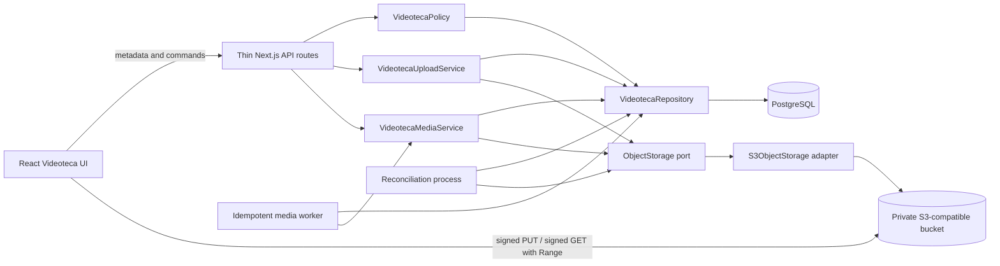
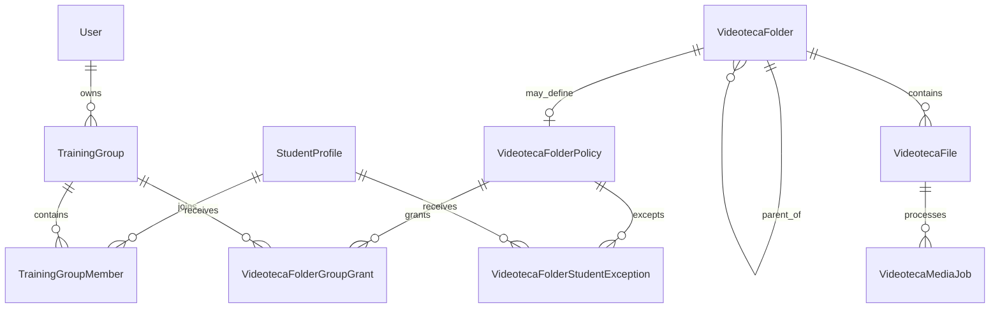
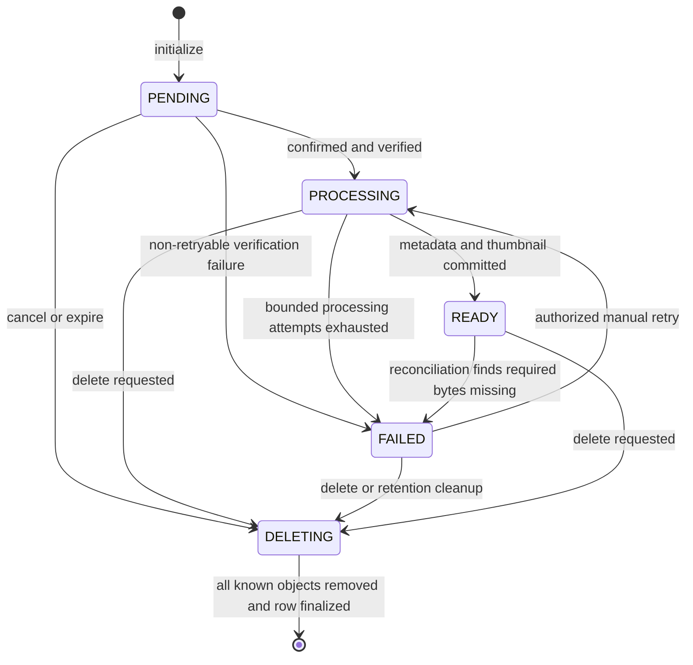

# Deliver a Private, Authorization-Correct Production Videoteca

**Status:** Approved design

**Date:** 2026-09-13

**Scope:** `agustinturriedf/web` Videoteca storage, authorization, media lifecycle, API contracts, UI, and operations

## Executive summary

Replace Videoteca's local-filesystem implementation with a production architecture in which PostgreSQL owns metadata, lifecycle state, authorization, and durable media-processing jobs while a private S3-compatible bucket owns media bytes. Every read requires an active authenticated session and a server-side policy decision. Authorized clients receive short-lived signed URLs; no object or thumbnail is public, no signed URL is persisted, and no application route proxies complete media files.

Visibility is hybrid. A folder policy is either `GLOBAL` or `RESTRICTED`, and applies to its descendant folders and files through inheritance. Restricted content is owned by a trainer and is normally granted to reusable training groups, with explicit per-student `ALLOW` and `DENY` exceptions. The exact authorization precedence is: **ADMIN -> owner TRAINER -> student DENY -> student ALLOW -> authorized group -> GLOBAL -> deny**. Files never carry their own ACL.

Uploads move directly from the browser to object storage: initialize a `PENDING` database row, issue a signed `PUT`, upload with per-file progress, confirm the upload, verify the stored object, and enqueue idempotent metadata and thumbnail processing. Only `READY` files are consumable. `FAILED`, `DELETING`, expired `PENDING`, orphaned objects, and incomplete records have explicit recovery paths. A failure for one selected file does not roll back files that succeeded.

The UI remains hierarchical and adds working grid/list views, server-side query controls, complete folder and file operations, a visibility panel, direct-upload recovery, image and video viewers, bulk operations, and role-aware actions. The current promotional featured-video and daily-tip content is removed until a real product requirement exists.

## Current state and production problem

### Verified request and storage path

The current flow is:

```text
React Videoteca pages
  -> browser fetch/XMLHttpRequest helpers
    -> Next.js API route handlers
      -> VideotecaService
        -> Prisma/PostgreSQL metadata
        -> server-local filesystem bytes and thumbnails
```

Evidence in the current repository:

| Area | Current evidence | Production consequence |
| --- | --- | --- |
| React UI | `agustinturriedf/web/app/(private)/videoteca/page.tsx` and `agustinturriedf/web/app/(private)/videoteca/[folderId]/page.tsx` | The client owns substantial query, upload, selection, and presentation state. Several rendered controls do not complete a real product action. |
| Client transport | `agustinturriedf/web/app/(private)/videoteca/videoteca.service.ts` | Metadata uses `fetch`; upload uses `XMLHttpRequest` to send multipart bytes through Next.js; download buffers a response into a browser `Blob`. |
| API routes | `agustinturriedf/web/app/api/videoteca/folders/`, `agustinturriedf/web/app/api/videoteca/files/` | Routes authenticate, then delegate to the current service. View and download routes stream server-local files and do not implement HTTP Range handling. |
| Application logic | `agustinturriedf/web/features/videoteca/service.ts` | Role checks allow `ADMIN` and `TRAINER` mutations, but folder and file reads are not scoped to an audience. Upload writes database and filesystem state in one procedural loop with incomplete compensation. |
| Metadata persistence | `agustinturriedf/web/features/videoteca/repository.ts` and `agustinturriedf/web/prisma/schema.prisma` | PostgreSQL stores folder hierarchy and file paths, but not ownership, visibility, ACLs, media lifecycle, verified media metadata, or durable processing work. |
| Byte persistence and thumbnails | `agustinturriedf/web/features/videoteca/storage.ts` | Durable bytes depend on a local directory. Image thumbnails use `sharp`; video thumbnail generation attempts first-frame extraction through `sharp` and silently falls back when it fails. |
| Authentication and roles | `agustinturriedf/web/features/auth/session.ts`, `agustinturriedf/web/features/auth/authorization.ts`, and `agustinturriedf/web/prisma/schema.prisma` | Existing roles are `ADMIN`, `TRAINER`, and `STUDENT`; `StudentProfile.trainerId` exists, but no reusable group model exists. |
| Existing coverage | `agustinturriedf/web/features/videoteca/*.test.ts` and `agustinturriedf/web/app/api/videoteca/**/*.test.ts` | There is targeted service, storage, hierarchy, and route coverage, but no full authorization matrix, S3 contract, direct-upload lifecycle, reconciliation, worker idempotency, UI permission, bulk-action, or media-seeking coverage. |

### Specific gaps

1. **Deployment coupling:** local durable storage is unsuitable for horizontally scaled or ephemeral application instances.
2. **Authorization:** any authenticated reader can currently resolve globally readable folder/file metadata; there is no ownership, group grant, student exception, or inherited folder policy.
3. **Private caching:** the authenticated thumbnail route emits `Cache-Control: public, max-age=31536000, immutable`, allowing shared/public caching after the session check.
4. **Video delivery:** the view route streams a full `200` response without interpreting `Range`, preventing reliable seeking and efficient partial delivery.
5. **Cross-system consistency:** PostgreSQL and the filesystem cannot commit atomically. Upload and delete order can leave missing bytes, orphan bytes, or records that describe bytes that no longer exist.
6. **Rollback behavior:** a batch-level exception deletes database records for prior files while only removing a subset of written files, so compensation is incomplete and can also undo successful items.
7. **Media processing:** video thumbnail extraction is not based on a video-aware inspection pipeline and a failure is reduced to a warning rather than a recoverable state.
8. **Contract integrity:** service DTOs format dates for `es-AR`, while the client parses those strings with `new Date(...)` and also writes localized dates back into state. Presentation text is being used as data.
9. **Query scale:** sorting, searching, and pagination are performed over client-loaded arrays rather than authorized, bounded PostgreSQL queries.
10. **Incomplete UI behavior:** the root grid/list toggle is visual only; the root upload action has no behavior; selection lacks bulk move/delete; file cards do not open a dedicated viewer; failed queue entries can only be removed, not retried; and featured-video/tip actions are static promotional content.

## Goals and non-goals

### Goals

- Require an active authenticated session for every metadata query, signed URL, upload command, and mutation.
- Enforce exact role, ownership, group, student-exception, visibility, and inherited-folder rules in one policy boundary.
- Support `GLOBAL` and `RESTRICTED` folder visibility without permanent public links.
- Add reusable trainer-owned `TrainingGroup` and many-to-many `TrainingGroupMember` records.
- Store durable media and thumbnails in a private S3-compatible bucket under opaque keys.
- Upload browser-to-bucket without routing media bytes through Next.js.
- Make file state explicit through `PENDING`, `PROCESSING`, `READY`, `FAILED`, and `DELETING`.
- Persist processing jobs in PostgreSQL and make metadata/thumbnail workers idempotent and safe under concurrency.
- Detect and recover expired uploads, incomplete records, stale work, missing objects, and orphan objects.
- Provide server-side search, sort, pagination, and filters by media type, visibility, group, and state.
- Complete the approved folder, move, bulk, upload, visibility, viewing, seeking, download, retry, and state UX.
- Return ISO 8601 UTC timestamps as API data and localize only at the rendering boundary.
- Prove the design with the complete authorization, lifecycle, storage, integration, API, repository, UI, accessibility, and build test strategy below.

### Non-goals

- HLS packaging or delivery.
- Renditions, adaptive bitrate variants, or transcoding.
- Public bucket access, unauthenticated viewing, or permanent share links.
- Per-file ACLs.
- Migrating existing local Videoteca media; it is disposable test data.
- Choosing a specific S3-compatible service provider.
- Replacing the application's authentication framework.
- Redesigning user account lifecycle, trainer assignment, payments, routines, or unrelated modules.

## Design principles and invariants

1. **PostgreSQL is authoritative for state and permission; object storage is authoritative for bytes.** Object existence never grants access and object metadata never replaces domain metadata.
2. **The policy is the authorization boundary.** UI visibility is helpful but not authoritative; every route and every signed URL request calls `VideotecaPolicy`.
3. **Nothing is consumable before `READY`.** A byte object may exist while its row is `PENDING`, `PROCESSING`, `FAILED`, or `DELETING`, but no view, thumbnail, or download URL is issued.
4. **Signed URLs are capabilities with short lifetimes.** They are generated after authorization, returned over `no-store` responses, never persisted, and never logged.
5. **ACLs belong to folders.** A file inherits the effective policy of its folder; there is no file grant or exception table.
6. **External side effects are retryable, not transaction participants.** State transitions, leases, idempotency keys, and reconciliation address the unavoidable PostgreSQL/object-storage consistency gap.
7. **Each upload is independent.** A multi-file selection is a client orchestration of per-file lifecycles; one failure does not roll back another file.
8. **Contracts carry machine data.** Timestamps are ISO strings, sizes are integer bytes, duration is integer milliseconds, and display labels are derived in the UI.
9. **Opaque keys are not authorization.** They reduce information leakage but never replace a session and policy check.

## Architecture and component responsibilities

### Target component map



### Responsibilities

| Component | Owns | Must not own |
| --- | --- | --- |
| Thin API routes | Session requirement, route/query/body schema validation, application-service invocation, stable response envelope, correlation ID. | Prisma queries, ACL branching, S3 SDK calls, media processing, or filesystem reads. |
| `VideotecaPolicy` | Effective inherited policy resolution; role/ownership/group/exception precedence; authorization for read, mutate, move, policy edit, retry, delete, and URL issuance. | HTTP response construction, signed URL generation, or UI assumptions. |
| `VideotecaRepository` | Authorized query primitives, folder hierarchy, groups/members, policies/grants/exceptions, file state transitions, job claims/leases, optimistic concurrency, and transactions. | S3 calls or transport DTO formatting. |
| `ObjectStorage` port | Provider-neutral operations needed by the domain: sign `PUT`/`GET`, inspect object headers, read a bounded signature sample, stream processing input, put derivatives, delete, test existence, and list a controlled prefix for reconciliation. | Authorization, database state, provider selection, or business error messages. |
| `S3ObjectStorage` adapter | S3-compatible request signing, private object operations, normalized storage errors, bounded retries where safe, and contract-test compatibility. | Persisted URLs, public ACLs, policy decisions, or file-state transitions. |
| `VideotecaUploadService` | Initialize, refresh an unexpired upload capability, confirm, verify object size and real type, expire abandoned uploads, and transition/enqueue atomically. | UI queue state or metadata/thumbnail extraction. |
| `VideotecaMediaService` | Inspect verified objects, extract image/video metadata, create required thumbnails, write derivative objects, complete or fail files, retry processing, and honor deletion races. | User authorization or direct route handling. |
| Media worker | Claim PostgreSQL jobs with leases, invoke media processing, heartbeat/complete safely, retry bounded transient failures, and remain idempotent. | HLS, renditions, transcoding, or granting access. |
| Reconciliation process | Compare rows, jobs, and bucket objects; recover stale states; delete aged orphans; and report every correction. | Treating object listing as permission state or silently broadening access. |
| React UI | URL-backed query state, hierarchy, role-aware presentation, direct-transfer queue, progress/cancel/retry, viewers, accessible interaction, and reconciliation from contracts. | Authorization authority, permanent media URLs, or client-only filtering of an unbounded result set. |

### Package direction

Routes depend on application services and DTO schemas. Application services depend on `VideotecaPolicy`, `VideotecaRepository`, and `ObjectStorage` interfaces. Prisma and the S3-compatible SDK remain in adapters. React code depends only on versioned request/response contracts. This keeps local persistence details out of routes and keeps provider details out of policy and UI code.

## Proposed domain model

Names below describe the intended Prisma/domain shape; migrations must use repository conventions and explicit indexes.

### Enums

| Enum | Values | Meaning |
| --- | --- | --- |
| `VideotecaVisibility` | `GLOBAL`, `RESTRICTED` | Effective audience model of a folder policy. `GLOBAL` still means active authenticated users only. |
| `VideotecaFileState` | `PENDING`, `PROCESSING`, `READY`, `FAILED`, `DELETING` | Authoritative media lifecycle. |
| `VideotecaMediaType` | `IMAGE`, `VIDEO` | Server-verified media family. |
| `VideotecaStudentEffect` | `ALLOW`, `DENY` | Explicit student exception on a folder policy. |
| `VideotecaMediaJobState` | `PENDING`, `RUNNING`, `RETRY_SCHEDULED`, `SUCCEEDED`, `FAILED` | Durable inspection/thumbnail work state. |

### Entities and relations

#### `TrainingGroup`

- `id`, `name`, `normalizedName`, `ownerTrainerId`, `createdAt`, and `updatedAt`.
- `ownerTrainerId` references a `User` whose role is `TRAINER`.
- A trainer owns and manages their groups; an admin manages every group.
- `(ownerTrainerId, normalizedName)` is unique.
- Group deletion is rejected while a folder policy still grants it and reports the referenced-folder count.

#### `TrainingGroupMember`

- `groupId`, `studentProfileId`, `createdAt`, and `createdByUserId`.
- Composite primary key or uniqueness on `(groupId, studentProfileId)` implements many-to-many membership without duplicates.
- The member must reference an active student at command time. Membership never grants access after the student ceases to be active.
- Authorization reads membership live from PostgreSQL; membership is not copied into a session token.

#### `VideotecaFolder`

- Retains `id`, `name`, `parentId`, `createdAt`, and `updatedAt`.
- Adds `createdByUserId` and `version` for traceability and optimistic mutations.
- Hierarchy rules prevent self-parenting and cycles. Moving folders is not introduced by this design.
- A root folder must own an explicit `VideotecaFolderPolicy`. A child without one inherits the nearest ancestor policy. Setting a policy on a child makes that child the policy source for its subtree until another explicit descendant policy is encountered.
- Policy-source changes are transactional and invalidate affected query caches; the UI states how many descendants inherit the change before confirmation.

#### `VideotecaFolderPolicy`

- `id`, unique `folderId`, `visibility`, nullable `ownerTrainerId`, `version`, `createdAt`, and `updatedAt`.
- `RESTRICTED` requires `ownerTrainerId`; restricted content is always trainer-owned.
- `GLOBAL` may be admin-managed with no trainer owner or trainer-owned with `ownerTrainerId`.
- A trainer may create or change only a policy they own and may not transfer ownership. An admin may manage and transfer any policy.
- Changing or removing an explicit child policy changes the effective audience for its inherited subtree, never file-by-file.

#### `VideotecaFolderGroupGrant`

- `policyId`, `groupId`, `createdAt`, and `createdByUserId`.
- Unique on `(policyId, groupId)`.
- Group grants are meaningful for `RESTRICTED` policies. The service rejects stale, duplicate, or unauthorized group assignments.

#### `VideotecaFolderStudentException`

- `policyId`, `studentProfileId`, `effect`, `createdAt`, `updatedAt`, and `createdByUserId`.
- Unique on `(policyId, studentProfileId)` so a student cannot have simultaneous `ALLOW` and `DENY` rows.
- Updating an exception replaces its effect atomically. `DENY` wins over every student grant below owner/admin precedence, including `GLOBAL`.

#### `VideotecaFile`

- Identity and placement: `id`, `folderId`, `originalName`, `normalizedName`, `orderIndex`, `createdByUserId`.
- Byte identity: opaque `objectKey`, nullable opaque `thumbnailObjectKey`; neither contains user names, folder names, or original file names.
- Upload claims: `declaredContentType`, `expectedSizeBytes`, `uploadExpiresAt`.
- Verified metadata: nullable `mediaType`, `verifiedContentType`, `sizeBytes`, `width`, `height`, and `durationMs` while upload/processing is incomplete. The fields required for that media family are non-null invariants at `READY`.
- Lifecycle: `state`, `version`, `processingGeneration`, `confirmedAt`, `readyAt`, `failedAt`, `deletionRequestedAt`, `createdAt`, and `updatedAt`.
- Bounded diagnostics: nullable `failureCode`, sanitized `failureMessage`, and `failureRetryable`. Diagnostic text has a configured maximum length and excludes signed URLs, object responses, stack traces, and secrets.
- `(folderId, normalizedName)` remains unique for live records. Move and rename commands enforce it transactionally.
- API DTOs never expose object keys, raw storage errors, or internal job fields.

#### `VideotecaMediaJob`

- `id`, `fileId`, `generation`, `state`, `attemptCount`, `maxAttempts`, `availableAt`, nullable `leaseOwner`, `leaseExpiresAt`, `lastHeartbeatAt`, `completedAt`, safe `lastErrorCode`, `createdAt`, and `updatedAt`.
- Unique on `(fileId, generation)` makes enqueue idempotent.
- The only media workload is inspection plus thumbnail generation. This table does not represent HLS, renditions, or transcoding.
- Claiming uses a PostgreSQL compare-and-set/skip-locked pattern with a finite lease. Completion verifies file ID, generation, and current `PROCESSING` state.

### Relationship summary



### File state machine



State transitions use an expected version or compare-and-set predicate. A worker that finishes after a delete request cannot restore the file to `READY`. A repeated confirm, retry, or delete returns the current compatible result when its idempotency condition is satisfied; conflicting state changes return a stable conflict error.

## Authorization, inheritance, and precedence

### Session gate

Every operation first requires the existing authenticated session boundary. Student access additionally requires the existing active student condition. A signed URL may remain usable only until its short expiry; obtaining or refreshing it always repeats session and policy checks. There is no anonymous metadata route and no public object ACL.

### Effective folder policy

1. Start at the target file's folder or the target folder itself.
2. Walk toward the root until the nearest explicit `VideotecaFolderPolicy` is found.
3. Use that policy, its owner, its group grants, and its student exceptions for the target and inherited descendants.
4. Reject a hierarchy without an effective policy as an integrity error and deny access.
5. For a move, authorize the source operation and destination operation independently; after the move, the destination's effective policy applies.

The visibility panel distinguishes **Defined here** from **Inherited from `<folder>`**. Removing a child policy is an explicit "resume inheritance" command. Before policy replacement, inheritance restoration, or move, the UI shows whether the effective audience becomes broader or narrower.

### Exact read precedence

Evaluate in this order and stop at the first applicable result:

1. **ADMIN:** allow.
2. **Owner TRAINER:** allow when the actor is a trainer and `policy.ownerTrainerId` equals the actor's user ID.
3. **Student DENY:** deny when the active student's explicit exception is `DENY`.
4. **Student ALLOW:** allow when the active student's explicit exception is `ALLOW`.
5. **Authorized group:** allow when the active student is currently a member of at least one group granted by the policy.
6. **GLOBAL:** allow any remaining active authenticated actor when visibility is `GLOBAL`.
7. **Default:** deny.

This order means a student `DENY` blocks even `GLOBAL` content; a student `ALLOW` can grant restricted content without group membership; and an owner trainer or admin is not blocked by student exceptions. A non-owner trainer can consume `GLOBAL` content but cannot consume another trainer's `RESTRICTED` content.

### Action matrix

| Action | `ADMIN` | Owner `TRAINER` | Non-owner `TRAINER` | Authorized `STUDENT` |
| --- | --- | --- | --- | --- |
| Browse/view/download `GLOBAL` | Allow | Allow | Allow | Allow unless explicit `DENY` |
| Browse/view/download `RESTRICTED` | Allow | Allow | Deny | Allow only by explicit `ALLOW` or granted-group membership, unless explicit `DENY` |
| Create root folder | Allow | Allow, owned by actor | Not applicable | Deny |
| Create child folder | Allow | Allow inside owned policy scope | Deny | Deny |
| Rename/delete owned folder | Allow | Allow | Deny | Deny |
| Upload/rename/move/delete file | Allow | Allow for source and destination scopes owned by actor | Deny | Deny |
| Set visibility/grants/exceptions | Allow | Allow on owned policy; ownership transfer denied | Deny | Deny |
| Retry failed processing | Allow | Allow for owned content | Deny | Deny |
| Manage training group | Allow | Allow for own group | Deny for another trainer's group | Deny |
| View processing/failed diagnostics | Allow | Allow for owned content | Deny | Deny |
| Run reconciliation or view operational report | Allow | Deny | Deny | Deny |

Mutation policy is checked against persisted ownership, never a client-supplied owner. Bulk commands load and authorize every target before changing any row; an unauthorized target rejects the command without revealing which hidden resource caused the rejection.

## API contracts

### Contract conventions

- Preserve the existing `{ success: true, data }` and `{ success: false, error }` envelope while introducing explicit request/response schemas.
- Every timestamp is an ISO 8601 UTC string such as `2026-09-13T15:04:05.000Z`.
- Every list is bounded and server-filtered before pagination.
- Stable sorting always includes `id` as a final tie-breaker.
- Mutation requests include `expectedVersion` where stale writes could broaden visibility, overwrite a rename, move a resource, or change state.
- Mutation clients may send an opaque idempotency key for upload initialization, confirm, retry, delete, and bulk commands. The service scopes it to actor and operation.
- Signed URL responses use `Cache-Control: no-store`; DTOs do not store or echo URLs after expiry.

### Folder and browse endpoints

| Endpoint | Contract |
| --- | --- |
| `GET /api/videoteca/folders` | Lists authorized children of optional `parentId`; root when absent. Supports `query`, `sort`, `page`, `pageSize`, `visibility`, and `groupId`. Returns items, page, page size, total count, and total pages. |
| `POST /api/videoteca/folders` | Creates a root or child folder with name, `parentId`, and an explicit policy or inheritance choice. Restricted creation requires a trainer owner. |
| `GET /api/videoteca/folders/:folderId` | Returns authorized folder metadata, breadcrumb, effective policy summary, policy source, counts, and actor capabilities; it does not return an unbounded child/file collection. |
| `PATCH /api/videoteca/folders/:folderId` | Renames the folder with `expectedVersion`. Folder moving is not supported. |
| `DELETE /api/videoteca/folders/:folderId` | Deletes only an empty folder with no child folders and no files in any state. Returns `409 FOLDER_NOT_EMPTY` otherwise. |
| `GET /api/videoteca/folders/:folderId/files` | Lists authorized files in that folder. Supports `query`, `sort`, `page`, `pageSize`, `mediaType`, `visibility`, `groupId`, and management-only `state`. Consumer responses include only `READY`; management views may request other states. |
| `PUT /api/videoteca/folders/:folderId/access-policy` | Defines/replaces the folder policy or resumes inheritance. Accepts visibility, owner where permitted, group IDs, student exceptions, and `expectedVersion` as one transactional command. |

`FolderDTO` and `FileDTO` include an explicit `capabilities` object such as `canView`, `canUpload`, `canRename`, `canMove`, `canDelete`, `canManageVisibility`, and `canRetry`. The UI uses it to render actions, while services still authorize each command.

### Training-group endpoints

| Endpoint | Contract |
| --- | --- |
| `GET /api/training-groups` | Returns authorized groups with server-side name search and pagination. Admin may filter by owner; trainer sees own groups. |
| `POST /api/training-groups` | Creates a trainer-owned group. Admin supplies a trainer owner; trainer ownership is fixed to the actor. |
| `PATCH /api/training-groups/:groupId` | Renames a group with optimistic concurrency. |
| `DELETE /api/training-groups/:groupId` | Deletes only when no folder policy references the group, returning referenced-folder count on conflict. |
| `PUT /api/training-groups/:groupId/members` | Replaces membership transactionally from a validated student-profile ID set and returns the resulting member summary. |

### Upload and file command endpoints

| Endpoint | Contract |
| --- | --- |
| `POST /api/videoteca/uploads` | Initializes one file. Accepts folder ID, original name, declared content type, size bytes, and idempotency key. Returns file ID/state, signed `PUT`, required headers, and upload expiry. |
| `POST /api/videoteca/uploads/:fileId/url` | Refreshes the signed `PUT` for the same authorized, unexpired `PENDING` file. It does not create a second row or key. |
| `POST /api/videoteca/uploads/:fileId/confirm` | Verifies object existence, exact size, and real allowlisted type; atomically changes `PENDING` to `PROCESSING` and enqueues the generation job. |
| `PATCH /api/videoteca/files/:fileId` | Renames a mutable file with `expectedVersion`; extension/type is not changed by display-name edits. |
| `POST /api/videoteca/files/bulk-move` | Moves one or more files to a destination folder after source/destination authorization and duplicate-name validation. Storage keys do not change. |
| `POST /api/videoteca/files/bulk-delete` | Marks one or more files `DELETING` after complete authorization and returns their new states. Single delete uses the same command with one ID. |
| `POST /api/videoteca/files/:fileId/retry` | For an authorized retryable `FAILED` file, increments processing generation, changes it to `PROCESSING`, and enqueues one idempotent job. |
| `POST /api/videoteca/files/:fileId/access` | Accepts `VIEW`, `THUMBNAIL`, or `DOWNLOAD`; reauthorizes a `READY` file and returns a short-lived signed `GET` plus expiry. Download signing applies a sanitized attachment filename. |

The initialize response never includes storage credentials. Required signed headers are returned as data and the client must send them unchanged. The bucket's CORS policy permits only the deployed application origins and required `PUT`/`GET`/`HEAD` behavior; it does not make objects public.

### Error contract

| HTTP | Stable code examples | Meaning and UI behavior |
| --- | --- | --- |
| `400` | `VALIDATION_ERROR`, `UNSUPPORTED_MEDIA_TYPE`, `SIZE_MISMATCH` | Attach field errors; a real-type mismatch is not retryable without replacing the upload. |
| `401` | `UNAUTHENTICATED` | Redirect through the existing authentication flow; never return a signed URL. |
| `403` | `FORBIDDEN` | Keep current context, hide no additional data, and announce denial. |
| `404` | `NOT_FOUND`, `OBJECT_NOT_FOUND` | Show scoped not-found or recoverable upload state without exposing unauthorized existence. |
| `409` | `VERSION_CONFLICT`, `INVALID_FILE_STATE`, `DUPLICATE_NAME`, `FOLDER_NOT_EMPTY`, `POLICY_CONFLICT` | Preserve input, refetch current state, and require review before resubmission. |
| `410` | `UPLOAD_EXPIRED` | Remove stale capability, preserve the local file selection when available, and offer fresh initialization. |
| `413` | `FILE_TOO_LARGE` | Reject before signing when declared size exceeds limits; confirm repeats the size check. |
| `422` | `MEDIA_PROCESSING_FAILED` | Show bounded diagnostics and retry only when `failureRetryable` is true. |
| `429` | `RATE_LIMITED` | Retain queue state and respect server retry guidance. |
| `503` | `STORAGE_UNAVAILABLE`, `PROCESSING_UNAVAILABLE` | Preserve committed state and expose a retryable operation; never claim upload or deletion completion. |

Unauthorized and nonexistent resources return indistinguishable safe responses where revealing existence would leak restricted content.

## Lifecycle flows

### Direct upload

```mermaid
sequenceDiagram
    participant UI as Browser queue
    participant API as Upload API
    participant DB as PostgreSQL
    participant S3 as Private object storage
    participant W as Media worker

    UI->>API: Initialize one file
    API->>DB: Authorize folder; create PENDING row
    API->>S3: Sign PUT for opaque object key
    API-->>UI: fileId, signed PUT, headers, expiry
    UI->>S3: PUT bytes directly with progress
    UI->>API: Confirm fileId
    API->>S3: HEAD plus bounded signature read
    API->>DB: Verify size/type; PROCESSING + job atomically
    API-->>UI: PROCESSING DTO
    W->>DB: Claim job lease
    W->>S3: Inspect media and write private thumbnail
    W->>DB: Commit verified metadata and READY
    UI->>API: Poll/refetch authorized state
    API-->>UI: READY DTO
```

Initialization validates declared size, extension, media family, folder capability, duplicate normalized name, and quota before creating the row. Confirmation does not trust browser MIME or extension: it checks the stored object's exact size and a bounded content signature before enqueuing work. The worker performs full media-aware inspection and thumbnail extraction. Video processing uses a video-aware probe/decoder rather than attempting to decode a video container as an image. Processing may use bounded ephemeral workspace, but no application instance's filesystem is durable state or a serving dependency.

The thumbnail is a required private derivative for `READY`. If inspection or thumbnail generation cannot complete within bounded attempts, the file becomes `FAILED` with safe diagnostics. The source object remains available for a bounded manual-retry retention window; it is never consumable while failed.

For multiple files, the client runs this sequence independently with bounded concurrency. It retains successful `PROCESSING`/`READY` items even when another initialization, transfer, confirmation, or processing step fails. No batch-level rollback removes successful files.

### Upload cancel and retry

- Cancel aborts the browser transfer immediately, then requests deletion of the initialized file. If that cleanup request does not arrive, `PENDING` expiry performs it.
- A transport failure leaves an unexpired file `PENDING`. Retry asks for a fresh signed `PUT` on the same row/key, restarts that transfer, and confirms it.
- Expired `PENDING` work cannot be revived. The UI creates a fresh initialization while preserving the selected local `File` object when the browser still has it.
- A processing failure uses the separate file retry command. Only retryable failures expose that action; each retry increments `processingGeneration`.

### View, thumbnail, video seeking, and download

1. The UI asks the access endpoint for the required purpose.
2. The route requires the current active session, loads the file and effective folder policy, applies exact precedence, and requires `READY`.
3. `S3ObjectStorage` signs a purpose-specific `GET` with a short expiry. View and thumbnail are inline; download supplies a sanitized attachment name without changing the opaque key.
4. The API returns the URL and `expiresAt` with `Cache-Control: no-store`.
5. The browser fetches from the private bucket. Signed object responses use private, bounded caching whose maximum age does not exceed the URL's remaining lifetime.
6. Video controls communicate directly with S3-compatible byte-range handling, enabling native seeking without a Next.js byte proxy.

The UI requests a replacement URL after expiry only by repeating authorization. It does not write signed URLs to local storage, session storage, durable caches, analytics, or application state that survives the current view.

### Delete

1. Authorize every target and compare expected versions.
2. In one PostgreSQL transaction, move targets to `DELETING` and record deletion time. New access requests immediately fail.
3. Delete the thumbnail and source object by known keys. Missing objects count as idempotent success.
4. Delete/finalize the database row only after all known objects are absent.
5. If storage is unavailable, retain `DELETING`; reconciliation retries cleanup. The UI shows deletion in progress and disables all other actions.

A processing worker checks state and generation before writing a derivative and again before completion. If deletion wins the race, the worker deletes any derivative it produced and cannot transition the row back to `READY`.

### Manual processing retry

Retry requires `FAILED`, `failureRetryable = true`, ownership/admin authorization, and an existing valid source object. The transaction clears displayed diagnostics, increments generation, creates the unique generation job, and changes state to `PROCESSING`. Concurrent retries produce one job. If the source is missing or the failure is non-retryable, retry is rejected and delete/re-upload guidance is returned.

### Reconciliation and retention

Reconciliation runs on a schedule and is safe to repeat. It reports scanned, corrected, deferred, and failed counts without exposing keys in general logs.

| Condition | Reconciliation action |
| --- | --- |
| `PENDING` past `uploadExpiresAt` | Mark `DELETING`, remove any object at its key, then remove the row. |
| `PROCESSING` with an expired worker lease | Return the job to retry scheduling or mark the file `FAILED` after bounded attempts. |
| `READY` missing source or required thumbnail | Transition to non-consumable `FAILED`, record a safe integrity code, and alert operations. |
| `DELETING` with remaining objects | Retry idempotent deletion, then finalize the row. |
| `FAILED` past its bounded retention window | Transition to `DELETING`, remove source/derivative bytes, and finalize according to retention policy. |
| Object under the Videoteca prefix with no database owner | After a grace interval that excludes in-flight writes, delete the orphan and record a metric/audit result. |
| Media job whose file/generation no longer matches | Mark the job terminal without mutating the file; remove any derivative produced by stale work. |

Object listing is restricted to the configured Videoteca prefix. Age checks prevent an in-flight direct upload from being classified as an orphan before its confirmation window closes.

## UI, UX, and accessibility scope

### Information architecture and query state

- Preserve hierarchical browsing with a root view, child-folder sections, and a complete breadcrumb whose ancestors are authorized by the server.
- Implement real grid and list presentations for folders and files. The toggle changes rendered semantics and layout, has an announced selected state, and persists for the current user without becoming authorization state.
- Put `query`, `sort`, page, media type, visibility, group, and management-only state filters in the URL. Back/forward navigation and refresh reproduce the same server query.
- Search, sort, filters, and pagination call bounded server endpoints. The client never loads an unrestricted collection and filters it as the source of truth.
- Keep folders navigable while file filters are active, and clearly label filtered-empty separately from an empty folder.
- Render ISO timestamps through the user's locale at the view boundary; never parse localized display strings as API data.

### Role and ownership-aware actions

- Render actions from server-provided capabilities, with `VideotecaPolicy` remaining authoritative.
- `ADMIN` sees all management controls.
- `TRAINER` sees management controls only for owned content and own groups; non-owned global content is read-only.
- `STUDENT` sees only authorized consumption controls and no management surface.
- State-specific capabilities suppress access before `READY`, suppress mutation during `DELETING`, and expose retry only for authorized retryable `FAILED` files.

### Required interactions

- Full folder create, rename, and empty-folder delete at root and nested levels.
- File rename; move to an authorized destination; selection; bulk move; and bulk delete with consequence-aware confirmation.
- A visibility panel showing effective visibility, owner, policy source, inherited status, granted groups, student exceptions, and affected descendant count. It supports explicit policy definition and resuming inheritance.
- Direct upload queue with per-file and overall progress, bounded concurrent transfers, cancel, transport retry, expired-upload restart, processing retry, and independent success/failure retention.
- Image viewer with fit/zoom controls and an explicit signed download action.
- Video viewer with native play/pause, volume, full-screen behavior, duration, timeline, keyboard operation, and Range-backed seeking.
- `PENDING`, `PROCESSING`, `FAILED`, and `DELETING` management cards with plain-language status. Students never see non-`READY` items.
- After deletion completes, remove the item, preserve surrounding query context, and announce the result. If deletion remains pending, keep a disabled in-progress row until refetch confirms removal.
- Remove the featured-video section, daily-tip card, root floating upload action, and any nonfunctional action until backed by a product requirement and contract.

### Accessibility baseline

- Use semantic buttons, links, lists/tables, headings, labels, and breadcrumb navigation; do not require context-menu or pointer-only interaction.
- Grid/list choice, selected rows/cards, progress, processing state, and expanded menus expose programmatic state.
- Upload progress uses labelled progress elements or correct progressbar semantics without announcing every percentage change; completion and failure use a concise live region.
- Every dialog has an accessible name and description, initial focus, focus containment, Escape behavior when safe, and deterministic focus return.
- Destructive and audience-broadening confirmations name the affected folder/files and consequence. Color is never the only warning signal.
- Viewer controls are keyboard reachable; image zoom and video seeking have visible focus and accessible names.
- Bulk selection and operations are fully keyboard operable. Selection persists only for results still present and authorized after a refetch.
- Loading, initial error, empty, filtered-empty, expired upload, processing, failed, deleting, forbidden, and not-found states are distinct and announced appropriately.
- Responsive layouts preserve action reachability, readable diagnostics, progress, filters, and viewer controls at supported viewport widths and zoom levels.

## Error handling and consistency

- Translate Prisma uniqueness, optimistic-concurrency, storage, signing, inspection, and worker errors into stable domain codes at adapter/service boundaries.
- Do not catch and discard object deletion or thumbnail errors. Persist a recoverable state and safe code, then let retry/reconciliation continue.
- Database transactions contain only database work. No transaction stays open during browser transfer, S3 operation, media inspection, or thumbnail generation.
- Confirmation changes state and inserts the processing job atomically. A committed `PROCESSING` state without its current-generation job is an integrity violation repaired by reconciliation.
- Job handlers are idempotent by `(fileId, generation)`. Derivative keys are deterministic from opaque file ID plus generation, so retries overwrite only the current derivative and stale derivatives can be removed safely.
- Move changes folder metadata only; opaque object keys remain stable, avoiding copy/delete races. The destination policy applies immediately after commit.
- Bulk move validates all names and permissions before one atomic metadata transaction. Bulk delete atomically marks all authorized targets `DELETING`, then object cleanup proceeds independently per file.
- Client failure never implies server rollback. After an ambiguous timeout, the client refetches by resource/idempotency key before retrying.

## Security and privacy

- The bucket and every object remain private. Public-read ACLs, public bucket policy, website hosting, and permanent object URLs are forbidden.
- Signed URLs use the minimum operation, object key, required headers, and short lifetime. Upload URLs cannot list, read, or write another key.
- Object keys are random/opaque and contain no user email, student name, trainer name, folder name, or original filename.
- Validate file size before signing and after upload. Detect real media type from bytes, reject extension/content mismatches, and allowlist supported image/video formats.
- Process untrusted media in a resource-bounded worker with limits for input bytes, dimensions, duration, execution time, memory, and output size. Parser crashes and malformed media become safe failures.
- Sanitize `Content-Disposition` filenames and prevent control-character/header injection.
- Apply existing same-origin/CSRF protections to session-authenticated commands. Bucket CORS allows only required deployed origins, methods, and headers and never substitutes for signing.
- Rate-limit initialization, URL refresh, confirmation, access URL issuance, retry, and reconciliation triggers by actor and resource as appropriate.
- Redact query strings and signed headers from logs, traces, error reporting, analytics, and support exports. Never log signed URLs, credentials, object authorization headers, or raw storage responses that contain them.
- Private cache directives prevent shared caches from retaining thumbnails or media. Access responses are `no-store`; object response lifetime is bounded by signed capability lifetime.
- Policy queries use persisted user/group state on each request. Group membership or folder policy changes affect newly issued URLs immediately, subject only to the bounded lifetime of an already issued URL.

## Observability

### Structured events

Emit structured events with correlation ID, actor ID, file/folder ID, state transition, job generation, attempt count, safe error code, duration, and byte count where relevant. Do not include object keys in general application logs; restricted operational diagnostics may use a one-way key fingerprint.

Required event families:

- upload initialized, URL refreshed, confirmed, expired, cancelled, and verification failed;
- file state transition and rejected transition;
- media job claimed, lease renewed, retried, succeeded, exhausted, or discarded as stale;
- signed access granted or denied by purpose and policy reason category;
- delete requested, object cleanup succeeded/failed, and deletion finalized;
- policy/group/membership mutation with actor and affected resource IDs;
- reconciliation run started/completed and correction category counts.

### Metrics and alerts

- Counts and age percentiles for each file state.
- `PENDING` expiry rate and confirmation latency.
- Upload initialization, transfer-confirm, and real-type rejection rates.
- Processing queue depth, oldest available job age, lease expiry, attempts, duration, and failure rate by safe category/media type.
- Signed URL issuance/denial rate by purpose without URL values.
- Delete latency and `DELETING` age.
- Orphan, missing-object, missing-thumbnail, and repaired-record counts.
- Storage request latency/error rate and transferred bytes.

Alert on sustained oldest-job age, exhausted processing, aged `DELETING`, missing bytes for `READY`, repeated reconciliation correction, storage unavailability, and abnormal authorization-denial changes. Dashboards distinguish user validation failures from infrastructure failures.

## Operations and configuration

Configuration is validated at process startup and supplied through the deployment's existing configuration and secret mechanisms. The design requires:

- S3-compatible endpoint behavior, region/signing context, private bucket name, optional path-style behavior, and a dedicated Videoteca key prefix;
- credentials available only to application/worker runtime identities, never browser code or this document;
- upload URL lifetime, access URL lifetime, private cache maximum age, and `PENDING` expiration, with cache age never exceeding URL lifetime;
- allowed media types and maximum image/video bytes;
- processing lease length, heartbeat interval, bounded attempts, backoff, worker concurrency, media resource limits, and failed-media retention;
- reconciliation schedule, orphan grace interval, scan page size, and delete retry bounds;
- allowed browser origins and required S3-compatible CORS headers/methods.

Application and worker identities receive only the bucket actions needed by their ports. Production startup fails closed when required storage configuration is absent or the bucket is configured for public access. Health reporting separates API readiness, database readiness, storage reachability, and worker liveness; a temporary storage outage does not make an unauthorized fallback path available.

Operational procedures cover pausing new upload initialization, draining/pausing workers, inspecting state counts, retrying safe failed work through application services, running reconciliation, and rotating storage credentials without changing object keys or persisted URLs. None of these procedures requires serving from a local directory.

## Test strategy

### Unit tests

- Full `VideotecaPolicy` precedence table, including admin bypass, owner trainer, non-owner trainer, explicit student deny over global/group/allow, explicit allow, group membership, global fallback, default deny, inactive student, missing policy, and inherited policy source.
- Mutation matrix for admin, owner trainer, non-owner trainer, and student across folders, files, policies, groups, retry, move, delete, and operational actions.
- Folder ancestry, nearest-policy inheritance, policy removal/resumption, cycle defense, and destination-policy change.
- Every valid and invalid file-state transition, expected-version conflict, stale generation, and delete/worker race.
- Name normalization, duplicate rules, ISO DTO serialization, signed response expiry bounds, safe filename handling, and diagnostic truncation/redaction.

### Object-storage adapter contract tests

Run the same `ObjectStorage` contract against the S3 adapter test environment:

- signed `PUT` is key-scoped, expires, requires declared signed headers, and cannot read/list;
- `head`, bounded signature read, stream, derivative put, existence, delete, and prefix-list pagination normalize success and expected errors;
- signed view/thumbnail/download URLs are private, expire, preserve purpose-specific disposition, and support byte-range reads for video;
- delete is idempotent for a missing object;
- storage errors never leak credentials or complete signed URLs.

### Integration tests

- Initialize -> direct upload -> confirm -> process -> `READY` for image and video.
- Declared size mismatch, actual size mismatch, unsupported real type, extension/type mismatch, missing object, and expired confirmation.
- One failure in a multi-file queue leaves successful files intact.
- Cancel before/during upload, retry transport with refreshed URL, duplicate confirm, concurrent confirm, duplicate initialization idempotency, and upload/delete race.
- Worker claim concurrency, lease expiry, crash recovery, duplicate delivery, bounded retries, manual retry generation, stale completion, and thumbnail-write/delete race.
- `PENDING` cleanup, failed retention cleanup, stale processing repair, incomplete job repair, aged `DELETING`, missing `READY` bytes, and orphan-object deletion after grace.
- Move duplicate conflict and source/destination authorization; bulk move atomicity; bulk delete marking and independent cleanup.
- Policy/group/member changes reflected in subsequent reads and access URL issuance.

### Repository and API tests with PostgreSQL

- Real PostgreSQL constraints, transactions, indexes, hierarchy queries, policy joins, membership queries, pagination, stable sorting, search, and every filter.
- Route schema validation and stable envelopes/codes for folder, group, policy, upload, confirm, access, move, delete, retry, and query endpoints.
- Full role/ownership/visibility matrix at metadata list, detail, thumbnail, view, download, and mutation routes.
- Consumer lists never return non-`READY` rows; management state filters never bypass ownership.
- Unauthorized and nonexistent restricted resources do not reveal distinguishable sensitive details.
- All contract timestamps are ISO 8601 UTC and all numeric media fields remain numeric.

### UI tests

- Capability-driven actions for admin, owner trainer, non-owner trainer, and student, plus API-denial recovery when displayed capability becomes stale.
- Hierarchy, breadcrumb, real grid/list switching, URL-backed query/sort/filter/pagination, empty variants, and responsive rendering.
- Visibility panel inheritance source, group selection, student exceptions, audience-change confirmation, conflict refetch, and keyboard operation.
- Upload queue progress, bounded concurrency, cancel, transport retry, expiration restart, independent failures, processing polling, manual retry, and cleanup of transient object URLs.
- File selection, bulk move/delete, partial cleanup display, query-context preservation, and live announcements.
- Image viewer, video controls, signed URL expiry refresh, download, and Range-backed seeking.
- `PENDING`, `PROCESSING`, `FAILED`, `DELETING`, forbidden, not-found, storage-error, and stale-version states.

### Accessibility and system verification

- Automated accessibility checks plus keyboard-only journeys for browse, filters, menus, dialogs, visibility management, upload, bulk actions, image view, and video playback/seeking.
- Focus order/restoration, focus containment, accessible names/descriptions, progress semantics, live-region behavior, contrast, non-color cues, zoom, and supported responsive widths.
- Production build, lint, focused suites, PostgreSQL integration suite, adapter contract suite, and full repository test suite all pass in the supported environment.

## Acceptance criteria and definition of done

The production Videoteca is complete only when all of the following are proven:

- No Videoteca runtime path reads, writes, serves, or deletes durable media from a local filesystem.
- Every bucket/object is private; no API or DTO exposes a permanent/public URL; signed URLs are short-lived, purpose-specific, unpersisted, and issued only after current authorization.
- The exact authorization precedence is covered and passing: admin, owner trainer, student deny, student allow, granted group, global, then deny.
- Admin manages all content; trainers mutate only owned content; students consume only content authorized by the effective inherited folder policy.
- Folder ACL inheritance is deterministic, visible in the UI, and the only ACL mechanism; no per-file ACL exists.
- Training groups are reusable, trainer-owned, many-to-many with students, and authorization uses current PostgreSQL membership.
- Direct upload follows initialize -> `PENDING` -> signed `PUT` -> confirm/verify -> `PROCESSING` -> `READY` or `FAILED`.
- Object size and real media type are verified server-side before processing; required metadata and thumbnail exist before `READY`.
- Nothing in `PENDING`, `PROCESSING`, `FAILED`, or `DELETING` can be viewed, thumbnailed, or downloaded.
- Video playback and seeking use private signed object delivery with byte-range support; Next.js does not proxy full video bytes.
- Upload, confirmation, worker, retry, delete, and reconciliation paths are idempotent under tested concurrency and crash scenarios.
- A failed upload never rolls back another file that succeeded.
- Tested flows leave no orphan objects. Expired pending uploads, failed retention, stale jobs, incomplete records, and deletion failures are detected and recovered.
- Search, sort, pagination, and media type/visibility/group/state filters execute server-side over authorized queries.
- Folder CRUD, file move, bulk move/delete, visibility management, upload recovery, viewers, signed download, and all required state displays work for their authorized roles.
- Featured-video, daily-tip, and other nonfunctional actions are absent.
- API contracts use ISO 8601 UTC timestamps and numeric byte/duration values; localization occurs only in presentation.
- Full policy/state unit, S3 adapter contract, upload/cleanup/concurrency/idempotency integration, PostgreSQL repository/API, UI, keyboard accessibility, responsive, build, lint, and full-suite verification pass.

## Clean cutover and disposal of local test data

No media migration is performed. Existing local files and current Videoteca folder/file rows are disposable test data.

1. Prepare the private bucket configuration, CORS, runtime identities, PostgreSQL schema, indexes, and worker deployment in the target environment without enabling production upload traffic.
2. Verify the bucket is private and the application can perform only the `ObjectStorage` contract operations under its runtime identity.
3. Enter a bounded maintenance window and disable current Videoteca mutations so no local upload can race the cutover.
4. Delete existing `VideotecaFile` and `VideotecaFolder` test rows in dependency-safe order and remove the old local Videoteca media directory. Do not copy names, paths, thumbnails, or bytes into the new model.
5. Deploy the new repository, policy, services, thin routes, UI contracts, worker, and reconciliation process together. Remove local storage configuration and old byte-serving behavior.
6. Create fresh folders, policies, groups, memberships, and media through the production APIs only.
7. Run role-matrix smoke verification, image/video direct upload, processing, private view/seek/download, delete, and reconciliation checks before reopening mutations.
8. Confirm PostgreSQL state counts, bucket-prefix object ownership, no public access, no aged transient states, and no orphan objects from the smoke flow.

Rollback restores the previous application/schema deployment only for operational recovery; it does not attempt to preserve or reverse newly created production media into local test storage. Because the cutover intentionally discards test data, the maintenance decision and destructive cleanup must be explicitly approved in the deployment record.

## Risks and tradeoffs

| Risk or tradeoff | Consequence | Mitigation/accepted boundary |
| --- | --- | --- |
| PostgreSQL and object storage cannot transact together | Temporary divergent states are unavoidable. | Explicit states, idempotency, leases, expiry, delete ordering, and reconciliation make divergence visible and recoverable. |
| A signed URL remains valid until expiry after access is revoked | Revocation is not instantaneous for an already issued capability. | Keep expiry short, cache privately below that lifetime, never persist URLs, and reauthorize every refresh. This bounded window is accepted. |
| Inherited ACL queries and audience changes are more complex | Incorrect joins could overexpose content or make lists slow. | Central policy implementation, deny-on-integrity-error behavior, full matrix tests, transactional policy replacement, targeted indexes, and query-plan review. |
| Direct browser upload depends on correct CORS and client recovery | Misconfiguration or network changes can interrupt transfer after initialization. | Startup/contract checks, explicit required headers, per-file retries, cancellation, and pending expiry. |
| Untrusted media processing consumes CPU/memory and exercises parsers | Malformed or extreme files can exhaust workers. | Isolated bounded worker resources, strict allowlists/limits/timeouts, safe diagnostics, and backpressure. |
| Required thumbnails delay readiness | A valid source is unavailable until derivative work succeeds. | Observable queue, bounded retries, manual retry, and clear failed state; consistent `READY` quality is preferred over silent partial readiness. |
| No HLS/transcoding | Large/original videos may have less predictable bandwidth and codec compatibility. | Enforce supported formats/limits and use Range delivery. Adaptive delivery remains future work. |
| Many-to-many groups add a reusable domain outside existing schema | Membership and trainer ownership become new integrity surfaces. | Dedicated service/repository boundaries, explicit ownership rules, referential constraints, and authorization tests. |
| Clean cutover destroys current Videoteca data | Existing test folders/files will not survive. | This is intentional because the media is verified disposable; use a maintenance gate and fresh production creation only. |

## Future evolution

The boundaries permit later additions without changing today's access model: resumable multipart upload behind `ObjectStorage`, background virus scanning as an additional pre-`READY` gate, audit history for policy mutations, richer group management, captions, CDN delivery that preserves private signed authorization, and HLS/renditions/transcoding as separate job types and derivatives. None of these is part of this design or its definition of done.

## Recommended implementation slices for the later plan

Each slice should include schema/API/UI behavior relevant to that slice, tests, observability, and operational notes rather than postponing quality to a final phase.

1. **Domain and authorization foundation:** add enums, groups/members, folder policies/grants/exceptions, file lifecycle fields, repository interfaces, `VideotecaPolicy`, indexes, and exhaustive policy/state tests.
2. **Private object-storage boundary:** define `ObjectStorage`, implement `S3ObjectStorage`, validate configuration/fail-closed startup, establish private cache/signing behavior, and pass adapter contract tests.
3. **Independent direct uploads:** implement initialize, signed `PUT`, refresh, confirmation verification, per-file idempotency, expiry cleanup, and the client queue with progress/cancel/transport retry.
4. **Durable media processing:** add PostgreSQL media jobs, lease/idempotency behavior, media-aware metadata and thumbnail generation, `READY`/`FAILED` transitions, manual retry, worker metrics, and concurrency tests.
5. **Authorized consumption:** implement authorized folder/file queries, access URL issuance, image viewer, video Range seeking, signed download, private thumbnail handling, and complete read-role matrix tests.
6. **Management commands and server queries:** implement nested folder CRUD, policy/visibility panel APIs, groups, rename, move, bulk move/delete, server search/sort/pagination/filters, optimistic conflicts, and delete recovery.
7. **Complete contract-driven UI:** finish grid/list, URL-backed filters, capability-aware actions, state cards, bulk flows, responsive behavior, accessibility journeys, and remove nonfunctional promotional content.
8. **Reconciliation and clean cutover:** implement scheduled detection/correction, alerts/run reporting, retention, destructive test-data disposal, production smoke checks, and full build/lint/test evidence against the definition of done.

These slices are ordered so no production byte path is exposed before private storage, lifecycle, and authorization foundations exist, and no UI action is considered complete without its server contract and tests.
